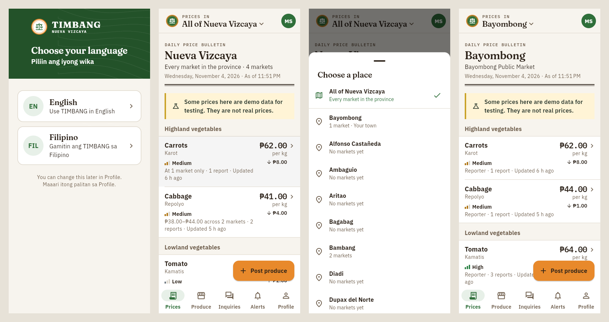
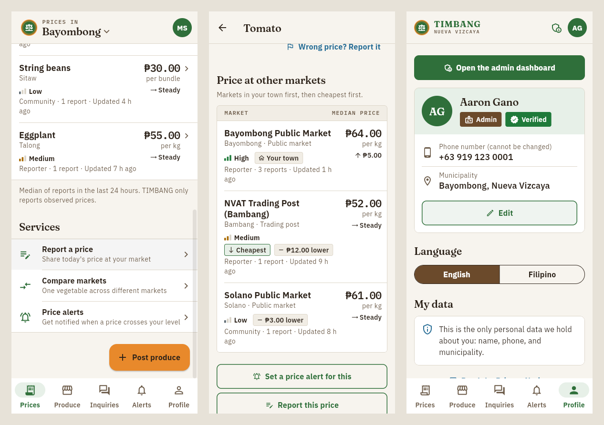
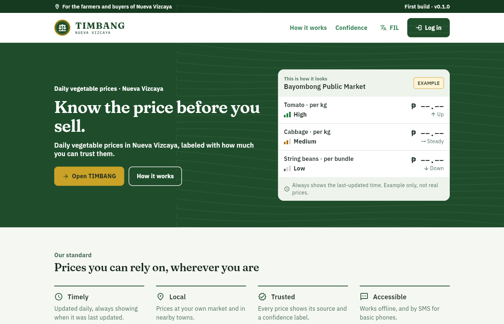
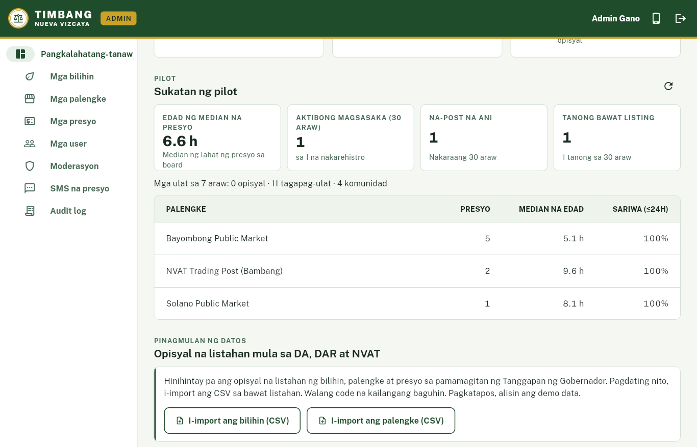
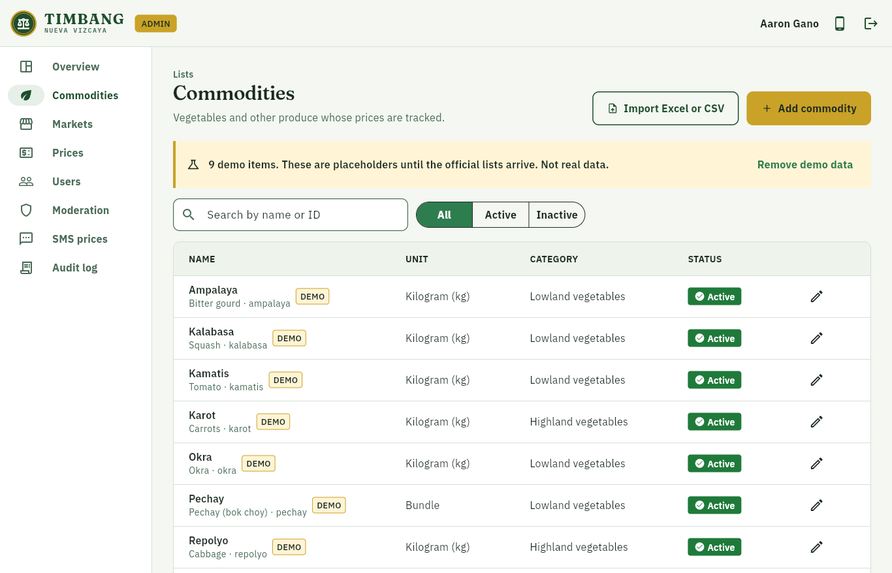
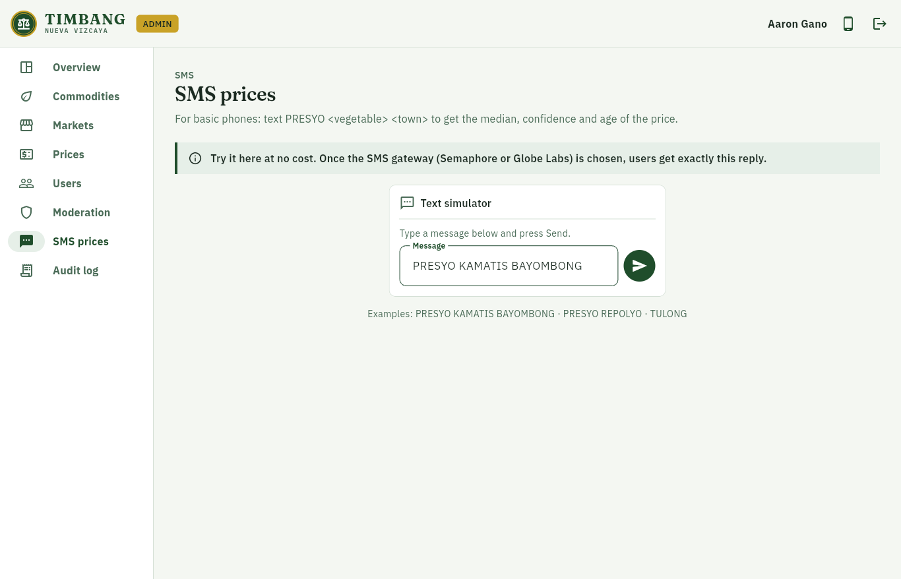

<div align="center">

# Project TIMBANG

### *Alamin ang presyo bago magbenta.*
**Know the price before you sell.**

A verified daily vegetable price board and produce marketplace for the farmers of
**Nueva Vizcaya, Philippines**, on Android, the web, and SMS.

`Flutter` · `Firebase` · `Cloud Functions (TypeScript)` · `English and Filipino`

**Status:** first build **v0.1.1**, a working prototype for a class requirement (see [Status](#status))

</div>

---

## What is TIMBANG?

*Timbang* is Filipino for **"to weigh."** Before selling, a farmer weighs the price, the buyer and
their options. TIMBANG gives them what they need to do that:

- **A daily price bulletin for the whole province.** Opening the app shows every vegetable across
  all markets in Nueva Vizcaya: the typical price, the range between markets, the change since
  yesterday in pesos, when it was last updated, and **how much the price can be trusted**
  (High / Medium / Low).
- **Switch to any municipality.** The header works like the town switcher in One Vizcaya: tap
  *Prices in · All of Nueva Vizcaya* and pick one of the 15 towns to see its own market(s). The
  choice is remembered on the phone, and the produce listings follow it.
- **Market comparison:** the same vegetable across nearby markets, so a farmer can see where it
  sells best.
- **Produce listings:** farmers post what they are harvesting, and buyers contact them directly.
- **Price alerts:** a notification when the price crosses a level the user chose.
- **SMS price check:** `PRESYO KAMATIS BAYOMBONG` returns the latest median price, even on a basic phone.
- **Works offline:** the last price board stays readable without signal, and listings posted
  offline are sent when the phone reconnects.

## Why it is needed

Small farmers often sell without knowing the current market price, so the price is often set by
whoever is buying. The existing sources fall short:

| Source | Gap |
|---|---|
| DA Bantay Presyo | Retail and consumer focused; reported to be Metro Manila centered |
| PSA Farm Price Survey | Periodic statistics, not daily |
| Facebook groups | Unverified and hard to search |

TIMBANG adds **local, daily prices with a trust label**, and a **direct route to buyers**.

**Design principles.** Every feature has to be:

1. **Timely:** updated daily and always showing its age.
2. **Local:** the user's own market and nearby ones first.
3. **Trusted:** every price shows its source and a confidence label.
4. **Actionable:** a price comes with a way to reach a buyer.
5. **Accessible:** works offline and by SMS, and on low-end Android phones.
6. **Complementary:** traders are buyers too. TIMBANG does not work against middlemen, who also
   provide transport and credit.

> TIMBANG **only reports observed prices**. It never sets or enforces prices.

## Who it is for

| Role | Who | What they can do |
|---|---|---|
| **Magsasaka** (farmer) | Vegetable, rice, corn and fruit growers | Check and compare prices, post produce, answer buyer inquiries, set alerts, report prices |
| **Mamimili** (buyer) | Traders, vendors, restaurants, households, institutions | Check prices, search produce, ask farmers, set alerts |
| **Tagapag-ulat** (reporter) | Cooperative officers, LGU market monitors, approved by an admin | Submit verified price reports that carry more weight |
| **Admin** | Provincial / municipal agriculture office staff | Manage the commodity and market lists, import official prices, approve reporters, moderate content, view pilot metrics |

People sign up with their **phone number** (one-time SMS code) and choose farmer or buyer.
Reporter and admin roles are granted only by an admin.

## Screenshots

**Mobile app:** first-launch language choice, the province-wide bulletin (the default), the
municipality switcher, and one town's bulletin



**Services, market comparison for one vegetable, and an admin's Profile** (the admin dashboard
button comes first)



**Website:** public landing page



**Admin dashboard:** overview and pilot metrics, the commodity list (Excel or CSV import), and the
SMS simulator





> The screenshots use **demo data** (marked DEMO in the app). They are not real prices.

## How a price earns its trust label

Each price on the board is computed by a Cloud Function every time a new report arrives
([`functions/src/confidence.ts`](functions/src/confidence.ts), fully unit-tested):

1. It takes the **median** of the last 24 hours of reports, never the average or the latest single report.
2. Reports more than **30%** away from the median are set aside as outliers and queued for admin
   review. Official reports are never set aside.
3. It assigns a confidence label:

| Label | When |
|---|---|
| **Mataas** (High) | An official price (DA / DAR / NVAT), or 3+ agreeing reports including a verified reporter |
| **Katamtaman** (Medium) | Reports from verified reporters |
| **Mababa** (Low) | Community reports only, until they are confirmed |

4. The **trend** compares the median with the previous day's (within ±3% counts as no change).
5. With no new report in 24 hours, the price **stays visible, marked "Luma na" (stale)**, and
   its age is always shown.

The source of each price is shown as **Opisyal** (official), **Tagapag-ulat** (reporter) or **Komunidad** (community).

**Province view (the default home screen).** Each vegetable is summarised across the markets that
have a price for it today:

- **Price:** the median of the markets' medians, so one market cannot pull it alone.
- **Range:** lowest to highest market price, and how many markets reported.
- **Confidence:** the *lowest* among those markets, so the province view never overstates trust.
- **Change:** the same median, compared with yesterday's.

Tap a vegetable to see each market separately.

## Features in this build

| Area | Included |
|---|---|
| Accounts | Phone OTP login, farmer/buyer self sign-up, profile, RA 10173 consent, view or copy my data, delete account |
| Prices | Province-wide bulletin by default; municipality switcher in the header (remembered on the phone); per-market board, market comparison, change since yesterday, confidence, source, age, stale label, offline cache |
| Reporting | Anyone can report a price; reporters count as verified; rate limits; outlier handling |
| Listings | Post produce (quantity, price, harvest date, town, photos), browse, filter, sort, mark sold, renew, automatic 14-day expiry |
| Inquiries | One message to the farmer, push notification, call/text buttons, inbox with unread badge |
| Alerts | Notification when the median crosses the user's price (once per crossing) |
| Admin | Works on the website and inside the mobile app (Profile → Open the admin dashboard, or the shield icon in the header). Commodities and markets (forms, Excel or CSV import), official price import (file or one price at a time), users and roles, reporter market assignment, moderation and user flags, audit log, pilot metrics, SMS simulator |
| SMS | `PRESYO <gulay> <bayan>` query behind a swappable gateway (mock for now; Semaphore or Globe Labs later) |
| Language | English by default; English or Filipino chosen on first launch, changeable in Profile |

## Design

The look is a mix of an **official printed price bulletin** and a **civic service** app:

- **Bulletin layout:** each screen opens with a masthead (place, date, "as of" time) over a double
  rule, and prices sit in full-width ruled lists grouped by category, without cards.
- **Light header:** the header sits on the page with a thin rule, not a solid green bar. It holds
  the seal, the municipality switcher and the profile.
- **Trust meter:** confidence is a 3-bar meter plus the word (▮▮▮ High, ▮▮▯ Medium, ▮▯▯ Low), so it
  never depends on color alone.
- **Services list:** plain rows (report a price, compare markets, price alerts), each with one
  sentence saying what it does. Farmers also get one *Post produce* button.
- **Type:** Fraunces (headlines and wordmark), IBM Plex Sans (text) and IBM Plex Mono (prices and
  data labels, like the readout of a weighing scale). All three include the peso sign and Filipino
  letters.
- **Accessible:** text contrast at least 4.5:1 (checked in tests), touch targets at least 48 dp,
  screen-reader labels on prices, trends and trust meters.
- **Language:** English by default. English or Filipino is chosen on first launch and can be
  changed in Profile or with the EN/FIL button on the website.

**Not part of TIMBANG** (by design): online payments or wallets, delivery and hauling, bookings,
ratings, open chat, shopping carts, and any price setting.

## Security and privacy

Security is graded for CS PC 7, so it is built in from the start:

- **Deny-by-default** Firestore and Storage rules, with tests for every collection (100+ rules tests).
- **Roles** live in Firebase custom claims set only by an admin-only function, never by the app
  itself. Typing `role: admin` into a Firestore document does nothing; the first admin is set with
  `npm run seed:admin` (see below). Reporters and admins are approved by an admin, which is what
  the **Verified** tag means. In this prototype the first admin is verified immediately. A fuller
  ID and endorsement check is planned for the pilot.
- **Prices are only written by the server.** It sets each report's trust tier and rate-limits submissions.
- Every admin action is recorded in an **audit log**.
- **App Check**, a signed SMS webhook, phone numbers hashed and masked in logs, and no analytics.
- **Data Privacy Act of 2012 (RA 10173):** only name, phone and town are collected. The privacy
  notice opens as its own full screen; *I agree* only unlocks after reading to the end. Users can
  view, copy and delete their data.

See [`docs/threat-model.md`](docs/threat-model.md) (STRIDE) and
[`docs/security-checklist.md`](docs/security-checklist.md) (OWASP MASVS).

## Testing

Every part of the system has automated tests, run against the Firebase Local Emulator Suite.
Last full run: **November 11, 2026, 393 tests, all passed.**

| Test suite | What it checks | Tests |
|---|---|---|
| App (`flutter_test`) | Screens, price board, imports, accessibility (text contrast, touch target size, labels), language | 106 |
| Cloud Functions (Jest) | Price confidence, roles, reports, imports, listings, inquiries, alerts, SMS, account deletion | 166 |
| Security rules (`@firebase/rules-unit-testing`) | Allowed and denied reads and writes for every collection and for Storage | 103 |
| Integration (Node test runner) | End-to-end function calls on the emulators: prices, roles, catalog, inquiries, SMS, admin | 18 |
| **Total** | | **393** |

## Tech stack

| Layer | Technology |
|---|---|
| App and website | Flutter (Android + web), Material 3, Riverpod, go_router; two themes from one token file: **Harvest Earth** (app) and **Forest and Gold** (website) |
| Auth | Firebase Authentication (phone OTP) + custom claims |
| Database | Cloud Firestore with offline persistence |
| Server logic | Cloud Functions for Firebase (TypeScript, `asia-southeast1`) |
| Files | Cloud Storage (compressed listing photos) |
| Notifications | Firebase Cloud Messaging |
| Integrity | Firebase App Check |
| SMS | `SmsGateway` interface (mock now; Semaphore or Globe Labs later) |
| Fonts | Fraunces, IBM Plex Sans, IBM Plex Mono (SIL OFL), bundled so they work offline |
| Tests and CI | flutter_test, Jest, `@firebase/rules-unit-testing`, emulator integration tests, GitHub Actions |

```
Phone / browser ──► Firebase Auth (phone OTP)
       │
       ├──► Firestore (rules-protected) ◄── Cloud Functions ──► FCM push
       │         ▲                              ▲
       └──► Callable functions (reports, inquiries, admin)
                                                │
Basic phone ──SMS──► gateway ──► smsWebhook ────┘
```

## Repository layout

| Path | Contents |
|---|---|
| `app/` | Flutter app. `lib/main_app.dart` is the mobile app, `lib/main_web.dart` the website + admin |
| `functions/` | Cloud Functions: price board, alerts, inquiries, roles, moderation, SMS |
| `firestore.rules`, `storage.rules` | Security rules (deny by default) |
| `tests/rules/`, `tests/integration/` | Rules tests and emulator integration tests |
| `scripts/` | Local tools: first admin, demo data, emulators on your Wi-Fi |
| `docs/` | Guides and design notes (see below) |

## Getting started

Requirements: Flutter 3.47+, Node 22, Java 21, `npm i -g firebase-tools`.

```bash
npm install && npm --prefix functions install
npm run emulators              # local Firebase: Auth, Firestore, Functions, Storage (UI at :4000)

# in another terminal
FIRESTORE_EMULATOR_HOST=127.0.0.1:8080 npm run seed:demo     # demo data (marked DEMO)

cd app && flutter pub get
flutter run -t lib/main_app.dart                # mobile app
flutter run -d chrome -t lib/main_web.dart      # website + admin
```

Debug builds connect to the local emulators automatically. Login codes are shown in the Emulator
UI (Authentication tab); no SMS is sent. To make yourself admin, sign in once, then run the command
below, sign out and sign in again. The app then shows **Open the admin dashboard** at the top of
Profile.

```bash
FIREBASE_AUTH_EMULATOR_HOST=127.0.0.1:9099 FIRESTORE_EMULATOR_HOST=127.0.0.1:8080 \
  npm run seed:admin -- +639171234567
```

**Demo logins on the real Firebase project** (no SMS cost): Firebase console → Authentication →
Sign-in method → Phone → *Phone numbers for testing*, e.g. `+63 917 000 0001` with code `123456`.
Remove them, or keep them private, before the pilot.

**Lists and prices after the build, from a phone:** the commodity, market and price lists live in
the database, not in the code, so no rebuild is needed. Admins add or edit them in the app
(Profile → Open the admin dashboard) or on the website, one at a time or by importing the office's
Excel (`.xlsx`) or CSV file as it is:

- names are enough (IDs are made from them), in Filipino or English;
- title rows above the header and section headings (e.g. *HIGHLAND VEGETABLES*) are skipped, and a
  heading becomes the category of the rows under it;
- units such as *per kilo*, *tali* or *pcs* are understood;
- price sheets can have one row per price, or one column per market.

Order: import the **markets**, then the **commodities**, then the **prices**. Editing needs an
internet connection (each change is checked and logged by the server); reading the price board
works offline. An empty list shows an *Add the list* button for admins.

**Tests**

```bash
npm run test:rules               # Firestore + Storage rules
npm --prefix functions test      # Cloud Functions unit tests
npm run test:integration         # functions against the emulators
cd app && flutter analyze && flutter test
```

**Building and deploying:** [`docs/BUILD.md`](docs/BUILD.md) (Firebase project, deploy, website)
and [`docs/APK_BUILD.md`](docs/APK_BUILD.md) (Android APK checklist and troubleshooting).

## Documentation

| Document | What it covers |
|---|---|
| [`docs/SETUP_CHECKLIST.txt`](docs/SETUP_CHECKLIST.txt) | One-page checklist (Notepad): PC setup → test on your phone → real Firebase project → pilot |
| [`docs/BUILD.md`](docs/BUILD.md) | Firebase project setup, deploy, website, first admin |
| [`docs/APK_BUILD.md`](docs/APK_BUILD.md) | Building and installing the Android APK |
| [`docs/data-model.md`](docs/data-model.md) | Firestore collections, fields and rules |
| [`docs/sms.md`](docs/sms.md) | SMS price query and adding a real gateway |
| [`docs/threat-model.md`](docs/threat-model.md) | STRIDE threat model |
| [`docs/security-checklist.md`](docs/security-checklist.md) | OWASP MASVS checklist |
| [`docs/pilot-metrics.md`](docs/pilot-metrics.md) | What the pilot measures |
| [`docs/usability-sus.md`](docs/usability-sus.md) | Usability test tasks and SUS questionnaire (Filipino/English) |
| [`docs/templates/`](docs/templates/) | CSV templates for commodities and markets |

## Status

**First build (v0.1.1): working prototype.** All MVP features are built and tested against the
Firebase emulators.

- **Data:** the commodity, market and price lists shown are **demo data**. The official lists
  from DA, DAR and NVAT have been requested through the Office of the Governor; when they arrive,
  admins import them from Excel or CSV, or type them in, with no code changes.
- **SMS:** the gateway (Semaphore or Globe Labs) has not been chosen yet. SMS works through the
  mock gateway and the admin simulator.
- **Pilot plan:** one public market (likely Bayombong) and one farmer group for about 4 weeks.

TIMBANG is an independent student project. It is **not yet affiliated with or endorsed by** the
Provincial Government of Nueva Vizcaya, DA, DAR or NVAT.

## About

Developed by **Aaron Anthony A. Gano II**, BS Computer Science (Robotics),
**Nueva Vizcaya State University**, Bayombong, as a joint requirement of
**IT ECC 6 – Application Development** and **CS PC 7 – Information Assurance and Technology**.

Typefaces, all under the SIL Open Font License and bundled in `app/assets/fonts`:
[Fraunces](https://github.com/undercasetype/Fraunces) for headlines and the wordmark,
[IBM Plex Sans](https://github.com/IBM/plex) for text, and IBM Plex Mono for prices and data
labels (like the readout of a weighing scale).
